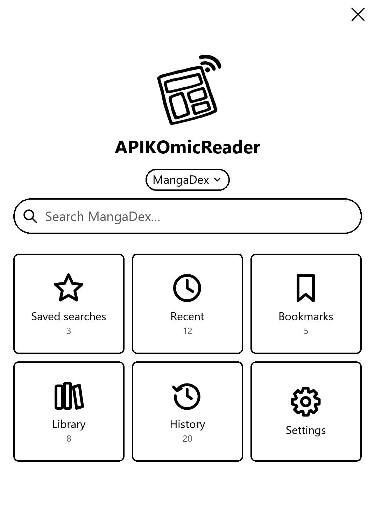
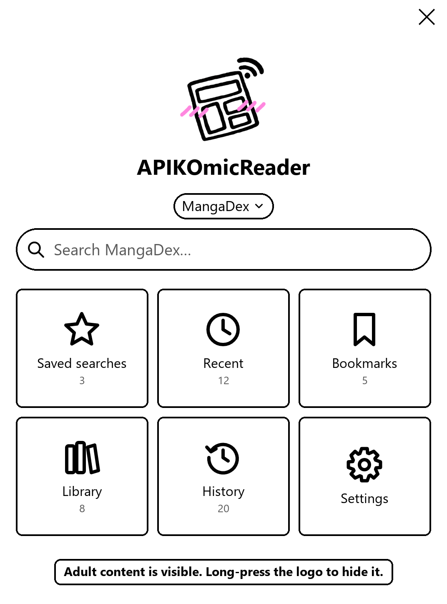

<p align="center">
  
</p>

<h1 align="center">APIKOmicReader</h1>

<p align="center">
  A <a href="https://koreader.rocks">KOReader</a> plugin for reading manga and comics straight from the internet.<br>
  <a href="README_ES.md">Léelo en español</a>
</p>

---

I wanted to read comics and manga on my Kindle without downloading stuff on my PC and copying it over every time, and I discovered that my main source for comics (mangadex) had an open API sooo... here it is.  You search a title/tag/number/whatever from the plugin, tap what you want and read it. The comics stay inside the plugin, so they don't end up mixed with your books.

<p align="center">
  
  &nbsp;&nbsp;
  <br>
  <em>The home screen (mockups). On the right, with adult content shown.</em>
</p>

## Sites

| Site | What's there |
| --- | --- |
| MangaDex | Loads of manga, in lots of languages. |
| Internet Archive | Western comics people have uploaded to archive.org, from Golden Age classics to Marvel and DC runs. Only uploads that contain actual comic files (CBZ/CBR) show up, so you skip most of the junk. |
| nhentai | Adult (18+) comics. Hidden unless you turn adult content on. |

A couple of things about the Internet Archive: it's whatever people upload, so quality and naming vary a lot. Sorting by "Most downloaded" (the default) helps. Uploads often contain a whole run, so you get one chapter per issue. It has no age ratings, so the adult content filter can't hide anything there, and pages always come in original quality. You can also paste an archive.org link in the search box to open that upload directly.

> **About that third one** 👀
> Yes, I know. In my defence, it's one of the very few comic sites with a proper f**king open API, and I needed something to check that the parental controls actually work. Purely for testing. Strictly professional. Nothing to see here.
>
> It is locked away by default, so unless you go looking for it (you degen) you won't even know it's there. You can also just delete `APIKOmicReader.koplugin/apiko/sources/nhentai.lua` if you dont want this depravity on your device.

You can add more sites yourself, see [For tinkerers](#for-tinkerers).

## Installing

You need KOReader on your e-reader first.

On Windows:

1. Plug the Kindle into your PC with a USB cable.
2. Double-click `unsetup.bat` and follow what it says.
3. Unplug the Kindle and restart KOReader.

Or by hand:

1. Plug in your e-reader and open its storage.
2. Copy the `APIKOmicReader.koplugin` folder into `koreader/plugins/`.
3. Unplug and restart KOReader.

Connect to Wi-Fi and open it from the Tools menu (the wrench icon) > APIKOmicReader.

## How to use it

On the home screen you've got:

- The site you're on, under the name. Tap it to change site.
- The search bar. Type a title and search. You can pick how results are sorted (popular, newest and so on), or search with nothing typed to just browse. If you'll want a search again, tap "Save this search".
- Saved searches: the searches you saved.
- Recent: your last searches.
- Bookmarks: stuff you want to read later.
- Library: comics you decided to keep, grouped by title.
- History: what you've read lately.
- Settings.
- Queue: when you have downloads waiting, a "Queue" button shows up at the top left (see [Download queue](#download-queue)).

There's a back arrow at the top left of every screen, and an X to close the plugin. When you close a comic you go back to where you were.

### Reading

1. Search and tap a cover to see what it's about.
2. Tap Read. For manga with chapters, tap Chapters and pick one.
3. Wait for the pages to download (tap the message to cancel) and it opens.

### Keeping stuff

- Bookmark a title to remember it without downloading anything.
- Save to library keeps a comic on the device for good. Useful before a trip with no Wi-Fi.
- For manga, the top of the chapter list has "Download all chapters" and "Download a range" (type chapter numbers, like `1-20`). They go to your Library, oldest first, and you can stop whenever. If a chapter has more than one translation, you only get one copy.
- Everything you read goes into History, which only keeps the last 20 to save space. To keep one, hold your finger on it and pick Save to library.

Holding your finger on most things gives you more options (save, remove, delete).

### Download queue

Don't want to sit and watch downloads? Line them up and let them run.

- Hold your finger on a result, or open a title's details, and tap "Add to download queue". In a chapter list, "Add all chapters to the download queue" queues the whole title, and holding a single chapter lets you queue just that one.
- Open the queue from the "Queue: N" button on the home screen (or the strip under the title bar in the grid and list views), then tap "Start downloading". Everything is saved to your Library, one title after another.
- Tap an entry to move it to the top or remove it. "Clear the queue" empties it.
- The queue survives restarts. A title that finishes leaves the queue; one that had a problem stays marked "failed" and gets tried again next time.
- You can cancel at any time by tapping the message.

### Parallel downloads and staying awake

Pages are fetched several at a time, which makes chapters download a lot faster. Pick how many in Settings > Parallel page downloads (1 to 6, default 3). If the site starts complaining or your Wi-Fi is bad, drop it to 1.

While a download or the queue is running, the plugin keeps the device awake so it doesn't go to sleep or lose Wi-Fi halfway through a big batch. Normal sleep comes back as soon as it's done.

### Library, collections and sorting

The Library groups the chapters you saved by title, so one manga is one entry instead of fifty. Tap a title to see its chapters. A title with a single saved chapter just shows up as that comic.

Each chapter shows whether it's unread, half-read (with a percentage) or read (✓). A title counts as read once you're about 97% of the way through, or if you mark it finished in KOReader.

**Collections** are your own groups of titles ("Reading now", "Superheroes", "Dropped"...):

- Hold your finger on a title and tap Collections... to add it to one or make a new collection.
- Collections show up first in the Library, in square brackets. Tap one to see its titles.
- Hold a collection to rename or delete it. Deleting a collection never deletes the comics inside it.
- Inside a collection, hold a title and pick "Remove from this collection".

**Sorting:** tap the Sort button at the bottom (or the first row in the simple list view).

| Library | Chapters of a title |
| --- | --- |
| Recently added | Chapter order |
| Oldest first | Newest chapter first |
| Name A-Z | Continue reading |
| Name Z-A | Unread first |
| Continue reading | |
| Unread first | |
| Read first | |

"Continue reading" puts what you're in the middle of first, most recently read on top. Your choice is remembered.

To get rid of a whole title, hold your finger on it and pick "Delete all chapters".

## Adult content and the PIN

Adult content is hidden by default. Adult sites don't show up, searches only give all-ages stuff, and any adult comics you already have are hidden too (that includes the download queue).

To show it, long-press the logo on the home screen. The logo blushes and a warning stays at the bottom of the screen while adult content is visible. Long-press the logo again to hide it.

If you don't want other people turning it on, set a PIN in Settings > Parental controls PIN. After that, long-pressing the logo asks for the PIN first, and everything hides again when you close the plugin or the device goes to sleep.

## Panels+

If you also have the [Panels+](https://github.com/KristanLaimon/PanelsPlus) plugin, it gets switched on whenever you open a comic, so you can zoom in panel by panel. Pick manga (right to left) or comic (left to right) order in Settings > Panels+. If you don't have it, nothing changes.

## ZenOS

If you use the [ZenOS](https://github.com/xZenLabs/zen-os) launcher, the plugin brings its own icon. In the launcher go to Buttons > Add > Plugin Menu > APIKOmicReader and choose the "apikomicreader" icon. If it's not in the list, turn on custom icons in ZenOS. No ZenOS? Then ignore this.

## Settings

| Setting | What it does |
| --- | --- |
| View | Results as a grid of covers, a list with covers, or a plain list. |
| Chapter language | Language for chapters, like `en` (English), `es` (Spanish) or `fr` (French). |
| Page images | "Data saver" is faster and smaller, "original" looks sharper. Only MangaDex has data saver. |
| Parallel page downloads | How many pages are downloaded at the same time (1 to 6). Default is 3. |
| Panels+ | Reading order for Panels+, or leave it alone. |
| Comics kept in history | How many recent comics to keep. Doesn't touch your library. |
| Parental controls PIN | Set, change or remove the PIN. |
| Test connection | Checks the current site works. |
| Clear history | Deletes the comics in History. Your library stays. |

The Library sort order and the chapter sort order are changed with the Sort button, not here.

## Problems

**It says the site is blocked.**
Some Wi-Fi networks (work, school) block comic sites. Try another one, like your phone's hotspot.

**A download failed halfway.**
Try lowering Settings > Parallel page downloads to 1 or 2. Failed titles stay in the download queue marked "failed", and hold/tap them to see the reason.

**My comics aren't with my books.**
That's on purpose. They're kept in a hidden folder and only show up in the plugin. They don't appear in KOReader's reading history either.

**I forgot the PIN.**
Plug the e-reader into a computer, open `koreader/settings.reader.lua` with a text editor and delete the `pin_hash` line in the `["apikomicreader"]` part. The PIN only locks the plugin, by the way. It doesn't protect the files.

**Something's broken.**
Try Settings > Test connection first. If that doesn't help, look in `koreader/crash.log`. The lines starting with `APIKOmic:` are the ones that matter.

---

## For tinkerers

### Adding a site

Every site is one file in `APIKOmicReader.koplugin/apiko/sources/`. Whatever is in that folder gets loaded when KOReader starts.

1. Copy `apiko/sources/_template.lua` and give it a new name, like `mysite.lua`.
2. Fill it in. The template explains each part and has an example. `mangadex.lua` (manga with chapters) and `nhentai.lua` (single comics) are real ones you can look at.
3. Copy the plugin to the device and restart KOReader.

Search, covers, downloads (parallel too), the queue, history, library, collections, bookmarks and the parental controls all work for the new site without changing anything else. If your site gives chapters a `number`, "Download a range" and the library's chapter order use it. If a site file has a mistake it just gets skipped and the reason goes in `crash.log` (search for `skipping source`). Files starting with `_` are ignored.

### Files

```
unsetup.bat                     Windows installer
tools/setup.ps1                 What the installer runs
docs/                           The pictures in this README
APIKOmicReader.koplugin/        The plugin, goes in koreader/plugins/
  main.lua                      Screens, navigation, downloads, queue, parental controls
  apiko/home.lua                Home screen
  apiko/browser.lua             Grid and list views with covers
  apiko/sources.lua             Loads the sites in apiko/sources/
  apiko/sources/                One file per site, plus _template.lua
  apiko/comics.lua              Downloaded comics and their reading progress
  apiko/library.lua             Groups the library by title and sorts it
  apiko/store.lua               Bookmarks, searches, collections and the download queue
  apiko/paths.lua               Where files go
  apiko/http.lua                Talks to the sites
  apiko/settings.lua            Settings
  apiko/zipwriter.lua           Packs pages into comic files
  assets/                       Logo, app icon and home screen icons
```

Downloaded comics go in the hidden folder `koreader/.apikomic/`, one folder per site. The queue, collections, bookmarks and searches are kept in `koreader/.apikomic/data.lua`.