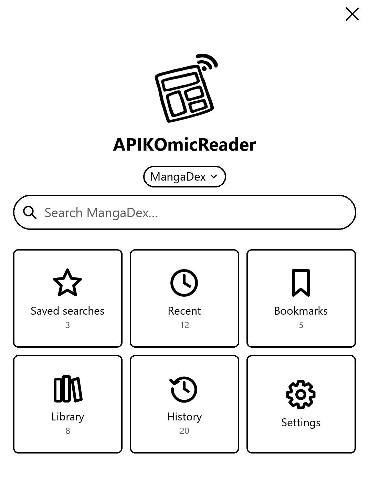
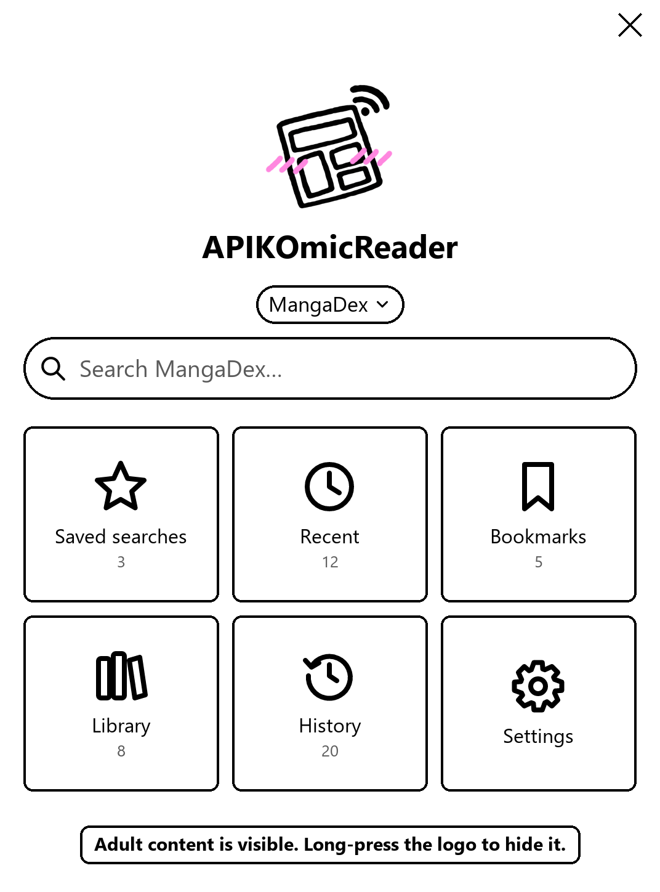

<p align="center">
  
</p>

<h1 align="center">APIKOmicReader</h1>

<p align="center">
  Un plugin para <a href="https://koreader.rocks">KOReader</a> para leer manga y cómics directamente de internet.<br>
  <a href="README.md">Read it in English</a>
</p>

---

Quería leer cómics y manga en el Kindle sin tener que descargarlos en el PC y pasarlos a mano cada dos por tres. Y resulta que mi fuente principal de cómics (MangaDex) tiene una API abierta, así que... aquí está. Buscas un título, una etiqueta, un número o lo que te dé la gana desde el plugin, tocas lo que quieras y a leer. Los cómics se quedan dentro del plugin, así que no se te mezclan con los libros.

<p align="center">
  
  &nbsp;&nbsp;
  <br>
  <em>La pantalla de inicio (maquetas). A la derecha, con el contenido adulto visible.</em>
</p>

## Webs

| Web | Qué hay |
| --- | --- |
| MangaDex | Mazo de manga, en un montón de idiomas. |
| Internet Archive | Cómics occidentales que la peña ha subido a archive.org, desde clásicos de la Edad de Oro hasta colecciones de Marvel y DC. Solo salen las subidas que tienen archivos de cómic de verdad (CBZ/CBR), así que te ahorras casi toda la morralla. |
| nhentai | Cómics para adultos (+18). Ocultos salvo que actives el contenido adulto. |

Un par de cosas del Internet Archive: es lo que sube la gente, así que la calidad y los nombres van como van. Ordenar por "Most downloaded" (lo que sale por defecto) ayuda mazo. Muchas subidas traen una colección entera, así que te sale un capítulo por número. No tiene clasificación por edades, así que el filtro de contenido adulto no puede ocultar nada ahí, y las páginas siempre vienen en calidad original. También puedes pegar un enlace de archive.org en el buscador para abrir esa subida directamente.

> **Sobre la tercera...** 👀
> Sí, ya lo sé. En mi defensa diré que es de las poquísimas webs de cómics con una puñetera API abierta como Dios manda, y necesitaba algo para comprobar que el control parental funcionaba de verdad. Solo para pruebas, ¿eh? Estrictamente profesional. Aquí no hay nada que ver, asi que tira.
>
> Viene bloqueada por defecto, así que salvo que te pongas a buscarla (guarrindongo) ni te vas a enterar de que existe. Y si no quieres esta depravación en tu dispositivo, borra `APIKOmicReader.koplugin/apiko/sources/nhentai.lua` y listo.

Puedes añadir más webs tú mismo, mira [Para los manitas](#para-los-manitas).

## Instalación

Primero necesitas tener KOReader en el lector.

En Windows:

1. Enchufa el Kindle al PC con el cable USB.
2. Dale doble clic a `unsetup.bat` y haz lo que te diga.
3. Desenchufa el Kindle y reinicia KOReader.

O a mano:

1. Enchufa el lector y abre su almacenamiento.
2. Copia la carpeta `APIKOmicReader.koplugin` dentro de `koreader/plugins/`.
3. Desenchufa y reinicia KOReader.

Conéctate al wifi y ábrelo desde el menú Herramientas (el icono de la llave inglesa) > APIKOmicReader.

## Cómo se usa

Los menús del plugin están en inglés, así que te pongo entre comillas cómo aparecen. En la pantalla de inicio tienes:

- La web en la que estás, debajo del nombre. Tócala para cambiar de web.
- La barra de búsqueda. Escribes un título y buscas. Puedes elegir cómo se ordenan los resultados (populares, más nuevos, etc.), o buscar sin escribir nada para cotillear lo que hay. Si vas a querer repetir una búsqueda, dale a "Save this search".
- "Saved searches": las búsquedas que has guardado.
- "Recent": tus últimas búsquedas.
- "Bookmarks": lo que quieres leer más adelante.
- "Library": los cómics que has decidido quedarte, agrupados por título.
- "History": lo último que has leído.
- "Settings": los ajustes.
- "Queue": cuando tienes descargas esperando, sale un botón "Queue" arriba a la izquierda (mira [Cola de descargas](#cola-de-descargas)).

Arriba a la izquierda de cada pantalla hay una flecha para volver, y una X para cerrar el plugin. Cuando cierras un cómic vuelves justo donde estabas.

### Leer algo

1. Busca y toca una portada para ver de qué va.
2. Dale a "Read". Si es un manga con capítulos, dale a "Chapters" y elige uno.
3. Espera a que se bajen las páginas (toca el mensaje si te arrepientes) y se abre solo.

### Guardarte cosas

- "Bookmark" para acordarte de un título sin bajarte nada.
- "Save to library" para quedarte un cómic en el lector para siempre. Viene de lujo antes de un viaje sin wifi.
- En los mangas, arriba de la lista de capítulos tienes "Download all chapters" y "Download a range" (escribes los números de capítulo, en plan `1-20`). Van directos a tu "Library", del más antiguo al más nuevo, y puedes pararlo cuando quieras. Si un capítulo tiene varias traducciones, solo te bajas una.
- Todo lo que lees va a "History", que solo guarda los últimos 20 para no llenarte el lector. Si te mola uno, mantén el dedo encima y elige "Save to library".

Si mantienes el dedo sobre casi cualquier cosa te salen más opciones (guardar, quitar, borrar).

### Cola de descargas

¿No quieres quedarte mirando cómo se baja todo? Pon las descargas en cola y que vayan solas.

- Mantén el dedo sobre un resultado, o abre los detalles de un título, y dale a "Add to download queue". En la lista de capítulos, "Add all chapters to the download queue" mete el título entero, y si mantienes el dedo sobre un capítulo puedes meter solo ese.
- Abre la cola con el botón "Queue: N" de la pantalla de inicio (o con la franja bajo la barra de título en las vistas de cuadrícula y lista) y dale a "Start downloading". Todo se guarda en tu "Library", un título detrás de otro.
- Toca una entrada para subirla arriba del todo o quitarla. "Clear the queue" la vacía.
- La cola se acuerda de todo aunque reinicies. Los títulos que terminan salen de la cola; los que han dado problemas se quedan marcados como "failed" y se vuelven a intentar la próxima vez.
- Puedes cancelar cuando quieras tocando el mensaje.

### Descargas en paralelo y que no se duerma

Las páginas se bajan de varias en varias, así que los capítulos van mucho más rápido. Elige cuántas a la vez en "Settings" > "Parallel page downloads" (de 1 a 6, por defecto 3). Si la web se queja o tu wifi va fatal, bájalo a 1.

Mientras se baja algo (o la cola), el plugin mantiene el lector despierto para que no se duerma ni pierda el wifi a mitad de una descarga gorda. En cuanto termina, vuelve a dormirse como siempre.

### Biblioteca, colecciones y orden

La "Library" agrupa por título los capítulos que te has guardado, así que un manga es una sola entrada en vez de cincuenta. Toca un título para ver sus capítulos. Si de un título solo tienes un capítulo, sale directamente ese cómic.

Cada capítulo te dice si está sin leer, a medias (con porcentaje) o leído (✓). Cuenta como leído cuando llegas más o menos al 97%, o si lo marcas como terminado en KOReader.

Las **colecciones** son tus propios grupos de títulos ("Leyendo ahora", "Superhéroes", "Abandonados"...):

- Mantén el dedo sobre un título y dale a "Collections..." para meterlo en una o crear una nueva.
- Las colecciones salen primero en la "Library", entre corchetes. Toca una para ver sus títulos.
- Mantén el dedo sobre una colección para renombrarla o borrarla. Borrar una colección nunca borra los cómics que tiene dentro.
- Dentro de una colección, mantén el dedo sobre un título y elige "Remove from this collection".

**Orden:** toca el botón "Sort" de abajo (o la primera fila en la lista simple).

| Biblioteca | Capítulos de un título |
| --- | --- |
| "Recently added" | "Chapter order" |
| "Oldest first" | "Newest chapter first" |
| "Name A-Z" | "Continue reading" |
| "Name Z-A" | "Unread first" |
| "Continue reading" | |
| "Unread first" | |
| "Read first" | |

"Continue reading" pone arriba lo que tienes a medias, y lo último que has leído el primero. Se acuerda de lo que elijas.

Para quitarte un título entero de encima, mantén el dedo sobre él y elige "Delete all chapters".

## Contenido adulto y PIN

El contenido adulto viene oculto por defecto. Las webs para adultos no aparecen, las búsquedas solo dan cosas para todos los públicos y los cómics para adultos que ya tengas también se esconden (la cola de descargas incluida).

Para mostrarlo, mantén pulsado el logo en la pantalla de inicio. El logo se pone colorado y abajo del todo sale un aviso mientras el contenido adulto está visible. Mantén pulsado el logo otra vez para ocultarlo.

Si no quieres que nadie más lo active, ponle un PIN en "Settings" > "Parental controls PIN". A partir de ahí, al mantener pulsado el logo te pide el PIN antes, y todo se vuelve a ocultar cuando cierras el plugin o el lector se bloquea.

## Panels+

Si además tienes el plugin [Panels+](https://github.com/KristanLaimon/PanelsPlus), se activa solo cada vez que abres un cómic, para que puedas ir viñeta a viñeta con zoom. Elige el orden manga (de derecha a izquierda) o cómic (de izquierda a derecha) en "Settings" > "Panels+". Si no lo tienes, no pasa nada, todo funciona igual.

## ZenOS

Si usas el lanzador [ZenOS](https://github.com/xZenLabs/zen-os), el plugin trae su propio icono. En el lanzador ve a Buttons > Add > Plugin Menu > APIKOmicReader y elige el icono "apikomicreader". Si no sale en la lista, activa los iconos personalizados de ZenOS. ¿No usas ZenOS? Pues pasa de esto.

## Ajustes

| Ajuste | Qué hace |
| --- | --- |
| "View" | Resultados como cuadrícula de portadas, lista con portadas o lista simple. |
| "Chapter language" | Idioma de los capítulos, como `es` (español), `en` (inglés) o `fr` (francés). |
| "Page images" | "Data saver" va más rápido y ocupa menos; "original" se ve más nítido. Solo MangaDex tiene "data saver". |
| "Parallel page downloads" | Cuántas páginas se bajan a la vez (de 1 a 6). Por defecto, 3. |
| "Panels+" | Orden de lectura para Panels+, o dejarlo como está. |
| "Comics kept in history" | Cuántos cómics recientes se guardan. Tu "Library" ni se toca. |
| "Parental controls PIN" | Poner, cambiar o quitar el PIN. |
| "Test connection" | Comprueba que la web actual va. |
| "Clear history" | Borra los cómics de "History". Tu "Library" se queda. |

El orden de la "Library" y el de los capítulos se cambian con el botón "Sort", no desde aquí.

## Problemas

**Dice que la web está bloqueada.**
Hay redes wifi (la del curro, la de clase) que bloquean las webs de cómics. Prueba con otra, por ejemplo compartiendo datos desde el móvil.

**Una descarga ha fallado a medias.**
Prueba a bajar "Settings" > "Parallel page downloads" a 1 o 2. Los títulos que fallan se quedan en la cola de descargas marcados como "failed"; tócalos y te dice el motivo.

**Mis cómics no salen con mis libros.**
Es a propósito, tío. Se guardan en una carpeta oculta y solo aparecen en el plugin. Tampoco salen en el historial de lectura de KOReader.

**Se me ha olvidado el PIN.**
Enchufa el lector a un ordenador, abre `koreader/settings.reader.lua` con un editor de texto y borra la línea de `pin_hash` dentro de la parte `["apikomicreader"]`. Ojo, que el PIN solo bloquea el plugin, no protege los archivos.

**Algo no va.**
Prueba primero "Settings" > "Test connection". Si sigue chungo, échale un ojo a `koreader/crash.log`. Las líneas que empiezan por `APIKOmic:` son las que importan.

---

## Para los manitas

### Añadir una web

Cada web es un archivo en `APIKOmicReader.koplugin/apiko/sources/`. Todo lo que metas en esa carpeta se carga solo al arrancar KOReader.

1. Copia `apiko/sources/_template.lua` y ponle otro nombre, en plan `miweb.lua`.
2. Rellénalo. La plantilla explica cada parte y trae un ejemplo. `mangadex.lua` (manga con capítulos) y `nhentai.lua` (cómics sueltos) son de verdad, por si quieres cotillearlos.
3. Copia el plugin al lector y reinicia KOReader.

La búsqueda, las portadas, las descargas (también en paralelo), la cola, el historial, la biblioteca, las colecciones, los marcadores y el control parental funcionan con la web nueva sin tocar nada más. Si tu web da un `number` a los capítulos, "Download a range" y el orden de capítulos de la biblioteca lo usan. Si el archivo de una web tiene algún fallo, simplemente se salta y el motivo queda en `crash.log` (busca `skipping source`). Los archivos que empiezan por `_` se ignoran.

### Archivos

```
unsetup.bat                     Instalador para Windows
tools/setup.ps1                 Lo que ejecuta el instalador
docs/                           Las imágenes de este README
APIKOmicReader.koplugin/        El plugin, va en koreader/plugins/
  main.lua                      Pantallas, navegación, descargas, cola, control parental
  apiko/home.lua                Pantalla de inicio
  apiko/browser.lua             Vistas de cuadrícula y lista con portadas
  apiko/sources.lua             Carga las webs de apiko/sources/
  apiko/sources/                Un archivo por web, más _template.lua
  apiko/comics.lua              Cómics descargados y su progreso de lectura
  apiko/library.lua             Agrupa la biblioteca por título y la ordena
  apiko/store.lua               Marcadores, búsquedas, colecciones y cola de descargas
  apiko/paths.lua               Dónde va cada cosa
  apiko/http.lua                Habla con las webs
  apiko/settings.lua            Ajustes
  apiko/zipwriter.lua           Empaqueta las páginas en archivos de cómic
  assets/                       Logo, icono de la app e iconos de la pantalla de inicio
```

Los cómics descargados van a la carpeta oculta `koreader/.apikomic/`, una carpeta por web. La cola, las colecciones, los marcadores y las búsquedas se guardan en `koreader/.apikomic/data.lua`.